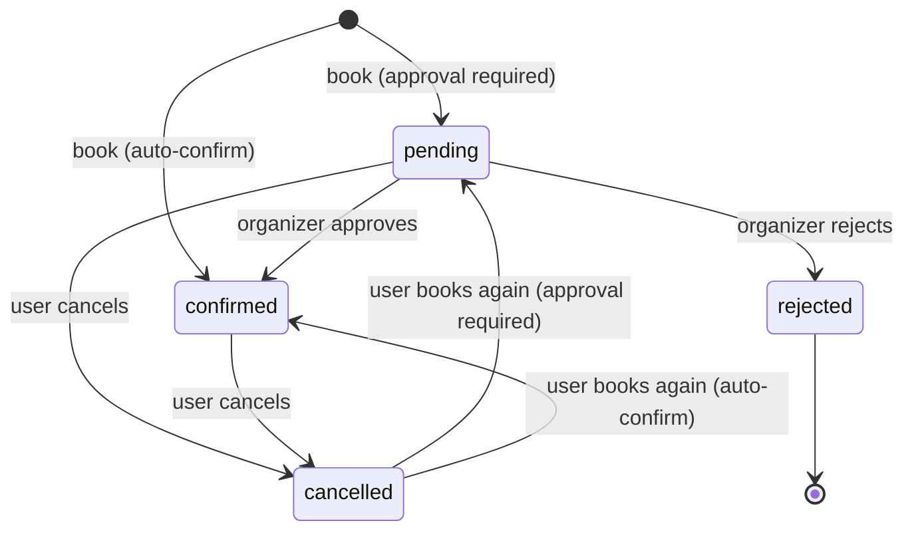

# 🎟️ Mini Meetups API

A RESTful API built with **Laravel** for creating meetups and booking seats in them, with optional **organizer approval**, **capacity limits**, and (coming next) **events, queues, and notifications**.

This is a **learning project**. Every file was written by hand to practise the backend concepts that real event platforms (like Luma or Eventbrite) depend on. The goal isn't feature count. The goal is understanding *why* each piece exists.

---

## 📑 Table of Contents

- [Business Overview](#-business-overview)
- [Business Rules](#-business-rules)
- [Booking Lifecycle (State Machine)](#-booking-lifecycle-state-machine)
- [Tech Stack](#-tech-stack)
- [Getting Started](#-getting-started)
- [API Endpoints](#-api-endpoints)
- [Project Structure](#-project-structure)
- [Request Lifecycle](#-request-lifecycle)
- [Concepts Applied](#-concepts-applied)
- [Roadmap](#-roadmap)

---

## 💼 Business Overview

**Mini Meetups** connects two kinds of people:

| Role | What they do |
|---|---|
| **Organizer** | Creates a meetup (title, location, start time, capacity) and decides whether bookings need manual approval. |
| **Attendee** | Browses upcoming meetups and books a seat. Can cancel and book again later. |

Any registered user can be both: an organizer of their own meetups and an attendee of other people's.

### Example flow

1. **Hager** creates *"Laravel Cairo"*: 50 seats, approval required.
2. **Ali** books a seat. His booking is **pending**.
3. Hager reviews the request and **approves** it. Ali's booking is now **confirmed**, and one seat is taken.
4. Ali can't make it, so he **cancels**. The seat is free again.
5. Ali changes his mind and **books again**. The same booking record moves back to **pending**.

---

## 📏 Business Rules

### Meetups
- Only the **organizer** can update or delete a meetup.
- A meetup must start **in the future**.
- Capacity is at least **1**.
- Capacity can't be lowered **below the number of confirmed bookings**. Those people need their seats.

### Bookings
- An organizer **cannot book their own meetup**.
- You can't book a meetup that has **already started**.
- A user has **at most one booking per meetup**. It's enforced by a database `unique` constraint.
- If the meetup **requires approval**, a new booking is `pending`. Otherwise it's `confirmed` right away.
- **Only confirmed bookings count toward capacity.** Pending requests don't hold a seat.
  - So capacity is checked **when a booking becomes confirmed**. That's either at booking time (auto-confirm) or at approval time.
- A **cancelled** booking can be re-activated by booking again. The existing row is reused.
- A **rejected** booking is final. The user can't request that meetup again, which stops spamming the organizer.
- Only the **booking owner** can cancel. Only the **meetup organizer** can approve, reject, or list bookings.

---

## 🔄 Booking Lifecycle (State Machine)



| From \ To | pending | confirmed | rejected | cancelled |
|---|:---:|:---:|:---:|:---:|
| **pending** | | ✅ | ✅ | ✅ |
| **confirmed** | | | | ✅ |
| **cancelled** | ✅ | ✅ | | |
| **rejected** | | | | |

Any other transition throws `InvalidBookingTransitionException` and returns **422**.

---

## 🛠️ Tech Stack

| Layer | Choice |
|---|---|
| Framework | Laravel 11+ (PHP 8.2+) |
| Database | MySQL |
| Authentication | Laravel Sanctum (API tokens) |
| Queue driver | `database` (Redis later) |
| Mail | SMTP (Mailtrap for development, or Gmail with an App Password) |

---

## 🚀 Getting Started

### 1. Install

```bash
git clone <repo-url> mini-meetups
cd mini-meetups
composer install
cp .env.example .env
php artisan key:generate
```

### 2. Configure `.env`

Create an empty MySQL database called `mini_meetups` first.

```env
DB_CONNECTION=mysql
DB_HOST=127.0.0.1
DB_PORT=3306
DB_DATABASE=mini_meetups
DB_USERNAME=root
DB_PASSWORD=

QUEUE_CONNECTION=database

MAIL_MAILER=smtp
MAIL_HOST=sandbox.smtp.mailtrap.io
MAIL_PORT=2525
MAIL_USERNAME=your_mailtrap_username
MAIL_PASSWORD=your_mailtrap_password
MAIL_ENCRYPTION=tls
MAIL_FROM_ADDRESS="no-reply@minimeetups.test"
MAIL_FROM_NAME="${APP_NAME}"
```

> ⚠️ Never commit `.env`. It holds secrets, and it's already in `.gitignore`.

### 3. Migrate and run

```bash
php artisan migrate
php artisan serve
```

### 4. Smoke-test the state machine

```bash
php artisan try:booking
```

This runs a scripted scenario (book → approve → cancel → re-book → invalid transition) and prints each status.

### 5. Calling the API

Send these headers with **every** request:

```
Accept: application/json
Authorization: Bearer <token>
```

Without `Accept: application/json`, validation errors come back as a **302 redirect** instead of a JSON **422**.

---

## 📡 API Endpoints

All routes are prefixed with `/api`.

### Auth

| Method | Endpoint | Auth | Description |
|---|---|:---:|---|
| `POST` | `/register` | | Register (`name`, `email`, `password`, `password_confirmation`) and get a token |
| `POST` | `/login` | | Log in and get a token. Rate-limited to **5 attempts per minute** |
| `POST` | `/logout` | ✅ | Revoke the **current** token only |
| `GET` | `/me` | ✅ | The authenticated user |

### Meetups

| Method | Endpoint | Who | Description |
|---|---|---|---|
| `GET` | `/meetups` | Any user | Upcoming meetups, paginated, with `spots_left` |
| `POST` | `/meetups` | Any user | Create a meetup. You become its organizer |
| `GET` | `/meetups/{meetup}` | Any user | Meetup details |
| `PATCH` | `/meetups/{meetup}` | Organizer | Update (partial) |
| `DELETE` | `/meetups/{meetup}` | Organizer | Delete |

### Bookings

| Method | Endpoint | Who | Description |
|---|---|---|---|
| `POST` | `/meetups/{meetup}/bookings` | Any user except the organizer | Book a seat, or re-book after cancelling |
| `GET` | `/meetups/{meetup}/bookings?status=pending` | Organizer | List bookings, with an optional status filter |
| `POST` | `/bookings/{booking}/approve` | Organizer | `pending → confirmed` (capacity checked) |
| `POST` | `/bookings/{booking}/reject` | Organizer | `pending → rejected` |
| `POST` | `/bookings/{booking}/cancel` | Booking owner | `pending/confirmed → cancelled` |

> **Why `POST /approve` and not `PATCH { "status": "confirmed" }`?** Each action has its own authorization rule and, soon, its own event. If one endpoint accepted any status, a user could send `"confirmed"` for their own booking.

### Status codes

| Code | Meaning in this API |
|---|---|
| `200` / `201` / `204` | Success / Created / Success with no body |
| `401` | Missing or invalid token. *Who are you?* |
| `403` | Policy denied. *You can't do this to that resource.* |
| `404` | Resource not found (route model binding) |
| `422` | Validation failed, or a business rule was broken (full meetup, invalid transition…) |
| `429` | Too many login attempts |

---

## 🗂️ Project Structure

```
app/
├── Enums/
│   └── BookingStatus.php            # Statuses, labels, allowed transitions
├── Exceptions/
│   ├── BookingException.php         # Business-rule errors (named constructors) → 422
│   └── InvalidBookingTransitionException.php
├── Http/
│   ├── Controllers/Api/
│   │   ├── AuthController.php
│   │   ├── MeetupController.php
│   │   └── BookingController.php    # Thin: authorize → call service → return resource
│   ├── Requests/
│   │   ├── Auth/{Register,Login}Request.php
│   │   └── Meetup/{Store,Update}MeetupRequest.php
│   └── Resources/
│       ├── UserResource.php
│       ├── MeetupResource.php
│       └── BookingResource.php
├── Models/
│   ├── User.php                     # organizedMeetups(), bookings()
│   ├── Meetup.php                   # organizer(), bookings(), confirmedBookings(), isOrganizedBy()
│   └── Booking.php                  # user(), meetup(), isOwnedBy(), transitionTo()
├── Policies/
│   ├── MeetupPolicy.php             # update, delete, viewBookings
│   └── BookingPolicy.php            # cancel, approve, reject
└── Services/
    └── BookingService.php           # book, approve, reject, cancel (transactions + locks)
```

### Database

```
users ─┬─< meetups (organizer_id)
       │
       └─< bookings >─ meetups
             unique(user_id, meetup_id)
```

| Table | Key columns |
|---|---|
| `meetups` | `organizer_id`, `title`, `description`, `location`, `starts_at` *(indexed)*, `capacity`, `requires_approval` |
| `bookings` | `user_id`, `meetup_id`, `status` *(no default, on purpose)* |
| `jobs` / `failed_jobs` | Queue storage. Used from step 6 onward |
| `personal_access_tokens` | Sanctum tokens, stored **hashed** |

---

## 🧭 Request Lifecycle

Each layer answers **one question** and fails with its **own status code**:

```
Request
  │
  ▼
[Middleware]     auth:sanctum ── Who are you?                     → 401
  │              throttle ────── Too many requests?               → 429
  ▼
[Route Binding]  {meetup} → Meetup::findOrFail()                  → 404
  │
  ▼
[Form Request]   authorize() → Policy ── Are you allowed?         → 403
  │              rules() ─────────────── Is your data valid?      → 422
  ▼
[Controller]     Gate::authorize() (if there's no Form Request)   → 403
  │              calls the Service
  ▼
[Service]        Business rules, transactions, locks              → 422
  │
  ▼
[Resource]       Shapes the JSON (whitelist)
```

---

## 🧠 Concepts Applied

### 1. Enums and attribute casting
`BookingStatus` is a **string-backed enum**. The allowed values live in one place, typos fail loudly, and the IDE can autocomplete them. The `status` cast on `Booking` turns the DB string into an enum object when reading, and back into a string when writing. An unknown value (like `'pending '` with a typo) throws a `ValueError`.

### 2. State machine
`BookingStatus::allowedTransitions()` defines which status can move to which. `Booking::transitionTo()` is the **only door** for changing a status, so the rules are checked every time. Final states (`rejected`) have no exits.

### 3. Don't add states you don't need (YAGNI)
A status must have a reason to **enter** it and a reason to **leave** it. `pending` was only added once organizer approval gave it a real exit. Otherwise it would have been a dead state.

### 4. Database constraints as the last line of defense
`unique(user_id, meetup_id)` blocks double bookings even if two requests slip past the application code at the same moment. `unsignedInteger('capacity')` blocks negative values. The `status` column has **no default**, so if the code forgets to set it, MySQL fails loudly instead of quietly storing a wrong value.

### 5. Status vs soft delete
Soft deletes keep the row, so the `unique` constraint still blocks re-booking. And a `cancelled` status already means "inactive". Business state belongs in a **status column**. Soft deletes are for data you want to hide but be able to recover.

### 6. Custom exceptions with `render()`
`BookingException` uses **named constructors** (`BookingException::meetupFull()`), so all messages live in one place. Its `render()` method returns a **422** JSON response, so breaking a business rule isn't reported as a 500 server error, and controllers don't need `try/catch`.

### 7. Form Requests
Validation lives outside the controller. `authorize()` runs **before** `rules()`. That's why ownership checks go there: a non-owner gets **403** and never sees a validation message that could leak data, like *"capacity must be at least 30"*. Rules can be dynamic. For example, the minimum capacity is calculated from current confirmed bookings.

### 8. Authentication vs authorization
- **Authentication** (`auth:sanctum`): *who are you?*
- **Authorization** (Policies): *can **you** do **this** to **that** resource?*

### 9. IDOR (Insecure Direct Object Reference)
Without a policy, any logged-in user could send `PATCH /meetups/5` and edit someone else's meetup, or approve their own booking. Every endpoint that touches an existing resource checks ownership.

### 10. Policies vs middleware vs Spatie Permission
| Tool | Question it answers | Knows the specific resource? |
|---|---|:---:|
| **Middleware** | Rules about the whole request (logged in? rate limit?) | ❌ |
| **Policy** | Rules about one resource (is this *your* meetup?) | ✅ |
| **Spatie Permission** | Roles and permissions stored in the DB (are you an admin?) | ❌ |

A policy is a plain class that returns `true` or `false`. It isn't a middleware. Middleware (`can:`), Form Requests, `Gate::authorize()`, and `$user->can()` are just different ways to **call** it. Spatie *complements* policies; it doesn't replace them. Spatie isn't used here because every rule is ownership-based (YAGNI).

Policy methods stay **separate even when their bodies match** (`update` and `delete`), because they're different business decisions that may change apart. The shared logic is pulled into the model instead (`isOrganizedBy()`, `isOwnedBy()`).

### 11. Route model binding
`/meetups/{meetup}` + `Meetup $meetup` makes Laravel fetch the model and return 404 if it doesn't exist. **Watch out:** type-hinting `User $user` on a route **without** `{user}` injects an empty `new User()`, with no error.

### 12. API Resources
Resources are a **whitelist** and a stable contract with the frontend. Columns added to the DB later don't leak out automatically.
- `whenLoaded('organizer')` / `whenCounted(...)` / `when(...)` include a key **only** if the controller prepared that data. Resources never run their own queries.
- Closures (`fn () => ...`) give **lazy evaluation**: the value is only computed when the condition is true.
- `status` (machine value) and `status_label` (human text) are both returned. The frontend compares the **value** and shows the **label**.

### 13. Eager loading and the N+1 problem
`with('user')` on a list turns 1 + N queries into 2. `load()` does the same for models you already fetched. `withCount('confirmedBookings')` counts inside the same query.

### 14. Pagination
Lists that can grow are **never** returned whole. `paginate()` adds `links` and `meta` (current page, total…). `simplePaginate()` and `cursorPaginate()` skip the `COUNT(*)` query for very large tables or infinite scroll.

### 15. Service layer and dependency injection
`BookingService` holds the business logic. It doesn't know about HTTP, so it can be reused from commands, jobs, and tests. The controller receives it through **constructor injection**, and Laravel's service container builds it. There's **one method per business action** (`book`, `approve`, `reject`, `cancel`) instead of a generic `changeStatus()`. Each action has its own rules, its own authorization, and soon its own event.

### 16. Race conditions, transactions, and pessimistic locking
Two users grab the last seat at the same millisecond. Both read *"49 of 50"*, and both get booked.

```php
DB::transaction(function () {
    $meetup = Meetup::whereKey($id)->lockForUpdate()->firstOrFail(); // SELECT ... FOR UPDATE
    // count confirmed bookings, then create/confirm
});
```

- `lockForUpdate()` makes other requests for **the same meetup** wait until the transaction commits, so they line up one after another.
- The lock only works **inside a transaction**.
- After the lock, `$booking->refresh()` reloads data that may have changed while we waited. **Decisions must be made on data read after the lock.**

### 17. Sanctum token authentication
Tokens are stored **hashed**. The plain-text token is shown once. `createToken('name')` labels the token, for example by device. Logout deletes only the **current** token. Login gives the same message for an unknown email and a wrong password, to prevent **user enumeration**.

### 18. Rate limiting
`throttle:5,1` on `/login` slows down brute-force attacks (**429**).

### 19. Fail loudly in development
```php
Model::preventSilentlyDiscardingAttributes(! app()->isProduction());
Model::preventLazyLoading(! app()->isProduction());
```
The first throws when you assign an attribute that isn't in `$fillable` (instead of dropping it silently). The second throws on lazy loading that would cause N+1 queries.

### 20. Conventions matter
`starts_at` (not `start_time`): date-time columns end in `_at`. `organizer_id` needs an explicit `constrained('users')` because it doesn't follow the `{model}_id` pattern.

---

## 🗺️ Roadmap

- [x] **1.** Project setup, MySQL, SMTP mail
- [x] **2.** Models, migrations, relationships, enums, state machine
- [x] **3.** Authentication with Sanctum
- [x] **4.** Meetups CRUD + policies, bookings + capacity + locking
- [ ] **5.** Events and listeners: `BookingRequested`, `BookingConfirmed`, `BookingRejected`, `BookingCancelled`, `MeetupDeleted`
- [ ] **6.** Queues: run listeners in the background (`ShouldQueue`, workers)
- [ ] **7.** Notifications: database and mail channels
- [ ] **8.** Delayed jobs and the scheduler: reminder one hour before the meetup
- [ ] **9.** Retries, backoff, and failed jobs
- [ ] **10.** *(Bonus)* Real-time notifications with Laravel Reverb

### Known improvements
- Lock the **booking row** (not just `refresh()`) in `approve` and `cancel` to fully close the cancel/approve race window.
- Turn `php artisan try:booking` into proper **Feature Tests**.
- Add token expiration.
